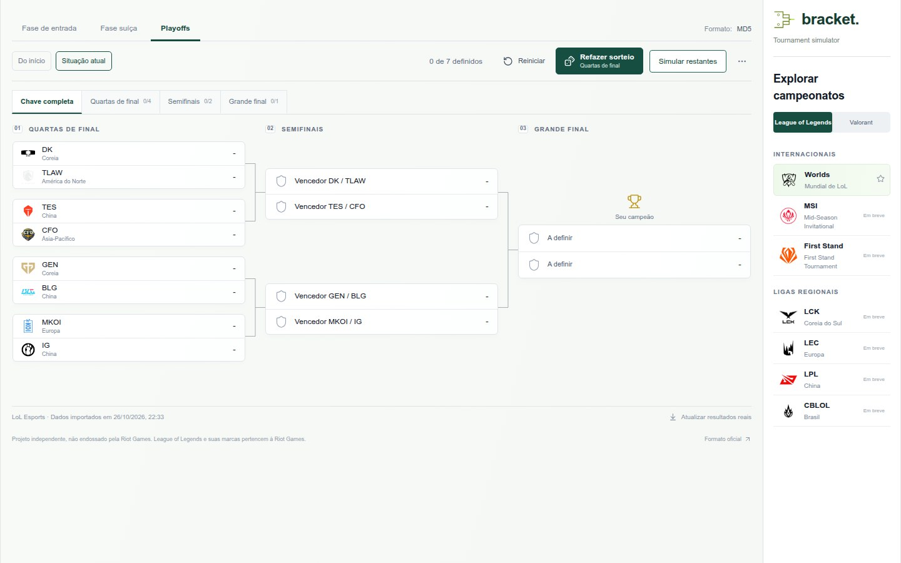
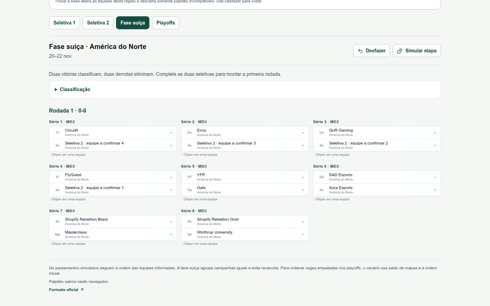
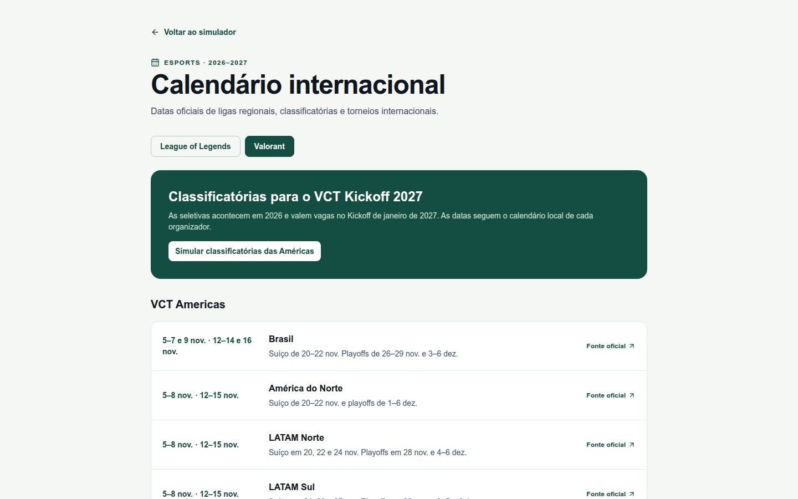
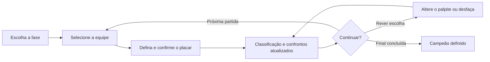
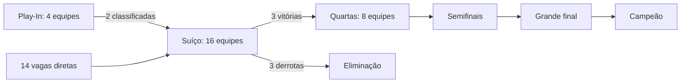
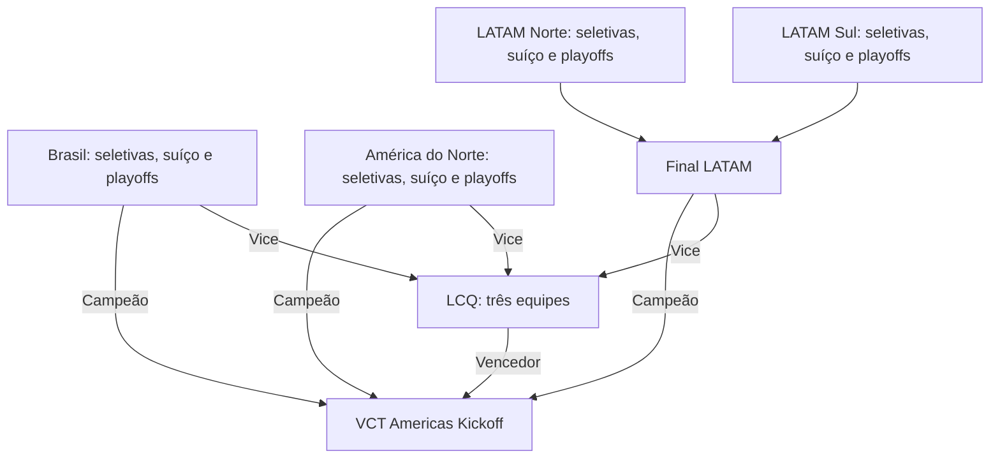
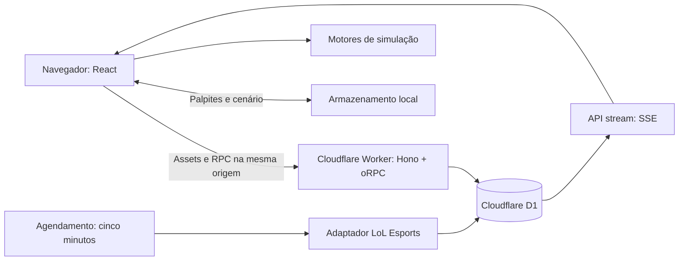

<div align="center">

# bracket.

### Seu caminho até o campeão.

Simule confrontos, explore classificações e acompanhe o calendário de **League of Legends** e **Valorant**.

[](https://github.com/joaokhalaf/esports-simulator/actions/workflows/ci.yml)

**[O simulador](#o-simulador) · [Como funciona](#como-funciona) · [Rodar localmente](#rodar-localmente) · [Documentação](#documentação)**

</div>



> Capturas da aplicação em ambiente local. Os cenários e pareamentos simulados são ilustrativos e não representam resultados oficiais.

## O simulador

Escolha uma equipe, defina o placar e veja os próximos confrontos se formando. Volte a uma escolha, explore outro sorteio ou complete uma etapa automaticamente: cada palpite recalcula o caminho até a classificação.

| Experiência                                       | Disponível hoje                                                                                               |
| :------------------------------------------------ | :------------------------------------------------------------------------------------------------------------ |
| **Worlds 2026 · LoL**                             | Play-In, fase suíça, classificação, playoffs e celebração do campeão.                                         |
| **Classificatórias VCT Americas 2027 · Valorant** | Brasil, América do Norte, LATAM Norte e LATAM Sul, com fase suíça, playoffs, final LATAM e LCQ.               |
| **Calendário · LoL e Valorant**                   | Datas e fontes de ligas regionais, seletivas e torneios internacionais; anúncios pendentes ficam sinalizados. |

**Palpites sem cadastro.** A simulação fica salva no navegador e pode ser retomada ao recarregar a página. A interface se adapta ao computador e ao celular, com navegação por fase e rodada.

### Worlds: da primeira série à grande final

- Comece **do início** ou pela **situação atual**, com os resultados reais preservados.
- Escolha vencedores e placares em séries MD1, MD3 e MD5.
- Explore outro caminho com **Refazer sorteio** ou **Simular restantes**.
- Reveja escolhas com **Desfazer**, no menu `⋯`, e reinicie com confirmação.
- Ao definir o campeão, veja sua equipe em destaque com animação e confetes.

### VCT Americas: quatro caminhos para o Kickoff



Parta dos classificados publicados e dos placares confirmados ou crie um cenário com equipes editáveis. Resultados reais ficam bloqueados para edição; cada região tem suas fontes e a data de consulta visíveis.

A base curada foi consultada em **11/11/2026**. O Brasil considera seis classificados da primeira seletiva, incluindo a repescagem. Equipes ainda desconhecidas da segunda seletiva e a vaga pendente do LATAM Sul aparecem como marcadores, sem serem apresentadas como participantes confirmadas.

### Calendário: o que vem pela frente



Alterne entre LoL e Valorant para consultar as datas e abrir as fontes de cada evento. O calendário também leva diretamente ao simulador das classificatórias das Américas.

**Consultar datas não significa que o torneio já pode ser simulado.** A simulação do CBLOL aguarda a divulgação do formato da próxima edição; as experiências jogáveis estão listadas acima.

## Como funciona

### Fluxo de um palpite



Alterar um resultado preserva os palpites compatíveis e descarta os que dependem de confrontos que deixaram de existir. Resultados reais e palpites são tratados separadamente.

### Caminho no Worlds



### Caminho nas Américas

Cada região reúne convidados e classificados das duas seletivas. No suíço regional, duas vitórias classificam e duas derrotas eliminam; os classificados seguem para playoffs de dupla eliminação.



## Dados reais e seus palpites

|                               | Worlds                                                                                                                | VCT Americas                                                    |
| :---------------------------- | :-------------------------------------------------------------------------------------------------------------------- | :-------------------------------------------------------------- |
| **Origem dos dados**          | Adaptador do LoL Esports e cópia de dados incluída no projeto.                                                        | Base curada com fontes de classificados, convidados e placares. |
| **Atualização**               | Coleta automática a cada cinco minutos; mudanças chegam pelo `/api/stream`. O menu `⋯` permite atualizar manualmente. | Atualização manual da base incluída no projeto.                 |
| **Se houver falha ou lacuna** | A versão anterior continua disponível para simular.                                                                   | Vagas e equipes ainda desconhecidas ficam sinalizadas.          |
| **Confrontos futuros**        | Usa os sorteios oficiais quando compatíveis; permite sorteios simulados.                                              | Pareamentos e seeds futuros são cenários de simulação.          |

No Worlds, o modo **Situação atual** recebe novos resultados automaticamente e preserva os palpites compatíveis. O modo **Do início** permanece livre: novas versões ficam disponíveis para aplicação explícita. A conexão se restabelece após uma queda e recupera a versão mais recente. No VCT Americas, a base ainda é manual. O agendamento remoto é ativado pelo deploy; os testes locais de cron estão descritos no guia Cloudflare.

Os palpites são locais: outro navegador ou dispositivo terá seu próprio cenário. Limpar os dados do site pode apagar suas escolhas.

## Rodar localmente

O caminho Cloudflare executa interface, API e banco D1 na sua máquina, **sem precisar de uma conta Cloudflare**.

**Requisitos:** Node.js 24 e pnpm na versão definida em `package.json` (12.14.0).

```sh
git clone https://github.com/joaokhalaf/esports-simulator.git
cd esports-simulator
pnpm install --frozen-lockfile
cp apps/server/.dev.vars.example apps/server/.dev.vars
pnpm run build:cloudflare
pnpm run db:migrate:local
pnpm run dev:cloudflare
```

Abra **[localhost:3101](http://localhost:3101)**.

| Rota                   | Experiência                         |
| :--------------------- | :---------------------------------- |
| `/`                    | Simulador do Worlds 2026.           |
| `/simulacoes/americas` | Classificatórias VCT Americas 2027. |
| `/calendario`          | Calendário de LoL e Valorant.       |
| `/health`              | Verificação da API.                 |

Depois de alterar a interface, execute `pnpm run build:cloudflare` novamente. A alternativa de desenvolvimento com Node.js e PostgreSQL está no [guia técnico do Worlds](docs/mvp.md).

## Arquitetura

**React + TypeScript** na interface, **Hono + oRPC** na API e **Cloudflare Workers + D1** na publicação. Os motores de simulação ficam separados da rede e do banco, com validação de contratos em Zod.



O D1 armazena os dados usados pelo servidor; os palpites feitos na interface ficam no navegador. O caminho Node.js/PostgreSQL também permanece disponível.

```text
apps/
  web/              Interface, calendário e simuladores
    src/lib/        Datas e fontes dos campeonatos
  server/           API Hono e entrada do Worker
packages/
  api/src/worlds/   Regras, motor e adaptador do Worlds
  api/src/vct/      Motor e base curada do VCT Americas
  db/               Acesso ao banco e migrações D1/PostgreSQL
  infra/            Infraestrutura e deploy com Alchemy
  ui/               Componentes compartilhados
```

## Qualidade e publicação

```sh
pnpm run ci                     # Biome
pnpm test                       # Testes de domínio e adaptadores
pnpm run check-types            # TypeScript
pnpm run build:cloudflare       # Interface e build do Worker em dry-run
pnpm run test:worker            # Integração com Worker e D1 efêmero
pnpm exec playwright install chromium
pnpm run test:e2e:cloudflare    # Fluxos reais no navegador
```

A CI verifica os caminhos Node.js/PostgreSQL e Cloudflare/D1. O teste de persistência PostgreSQL requer o banco temporário descrito no guia técnico.

A publicação usa **Alchemy** para criar ou atualizar o Worker, o D1 e suas migrações. Push em `master` publica homologação após os checks; tags `vMAJOR.MINOR.PATCH` publicam produção. Consulte o [guia Cloudflare](docs/cloudflare.md) para configurar os ambientes e as credenciais.

## Documentação

| Guia                                                          | Conteúdo                                             |
| :------------------------------------------------------------ | :--------------------------------------------------- |
| [Cloudflare](docs/cloudflare.md)                              | Execução local, deploy, D1, migrações e recuperação. |
| [CI/CD](docs/ci-cd.md)                                        | Checks, ambientes, artefatos e releases.             |
| [Worlds · guia técnico](docs/mvp.md)                          | Motor, adaptador e alternativa Node.js/PostgreSQL.   |
| [Calendário internacional](docs/international-tournaments.md) | Escopo, datas e fontes dos campeonatos.              |

---

Projeto independente, não endossado pela Riot Games. League of Legends, Valorant e suas marcas pertencem aos respectivos titulares. Os resultados simulados representam as escolhas do usuário.
